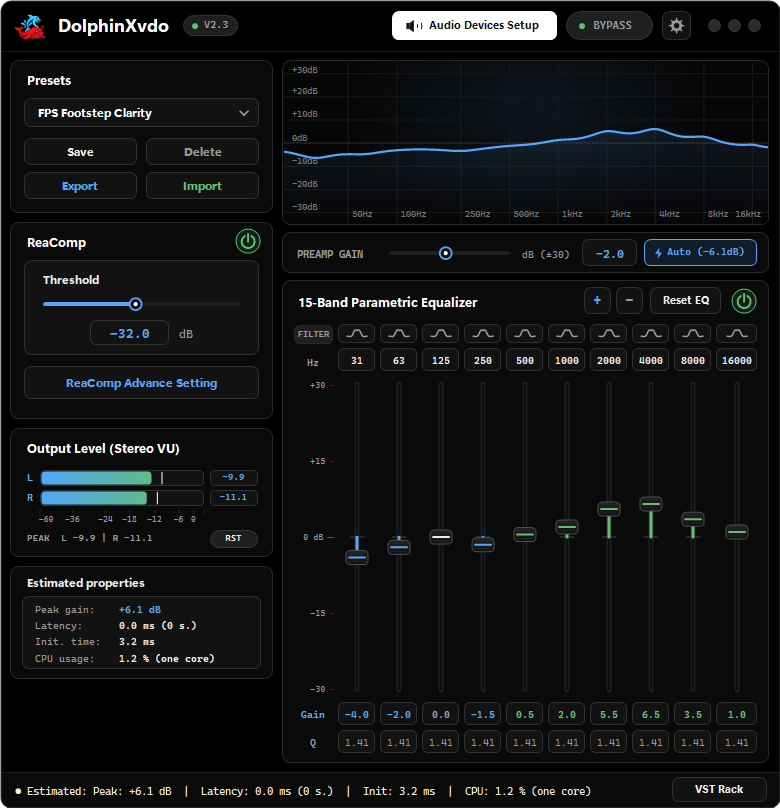
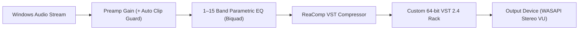

<div align="center">


# DolphinXvdo

**System-wide Windows Audio DSP Controller — Parametric EQ, Embedded ReaComp VST & Custom VST 2.4 Rack**  
*Built on Equalizer APO with a distraction-free Dark Tech interface.*

<p>
  <a href="https://github.com/plug56-vst-king/DolphinXvdo/releases/tag/v2.3.0">
    
  </a>
  
  
  
</p>

<p>
  <a href="https://github.com/plug56-vst-king/DolphinXvdo/releases/download/v2.3.0/DolphinXvdo-Setup-v2.3.exe">
    
  </a>
</p>

</div>

---

## UI / UX Showcase

<div align="center">
  
  <p><sub><b>DolphinXvdo v2.3</b> — Dark Tech interface with live biquad frequency graph, 15-band parametric EQ, embedded ReaComp threshold control, Ableton-style stereo VU meter, and native Windows 11 rounded corners.</sub></p>
</div>

### Design & UX Highlights

| Pillar | What It Means in Daily Use |
| :--- | :--- |
| **Dark Tech Visual System** | Pure `#000000` canvas, `#0a0a0a` rounded cards with subtle `1px` border rings, and native Windows 11 DWM rounded window corners — comfortable for long gaming, mixing, or late-night sessions. |
| **Monospace Data Integrity** | Every acoustic measurement (`Hz`, `dB`, `Q`, Peak Hold, Latency, Init time, CPU) uses crisp monospace typography (`Geist Mono` / `Cascadia Mono`) for zero visual jitter while dragging sliders. |
| **Color-Coded Signal Clarity** | Strict 3-color feedback: **Blue `#52a8ff`** for active curve / cut / focus, **Green `#62c073`** for boost / active DSP power, and **High-Contrast `#ededed`** for bypass / clip alerts. |
| **Single-Window Zero-Friction UX** | Presets, ReaComp, Stereo VU, Preamp, and 15-Band EQ all live on one compact `780 × 808` control surface — no tab hunting, no bloated menus, instant real-time APO sync. |
| **Pill Status Indicators** | Glanceable pill chips (`V2.3`, `BYPASS`, `RST`) let you check processing state or clear peak hold in a single click. |

---

## What Is DolphinXvdo? (เกี่ยวกับแอป)

**DolphinXvdo** is a lightweight, all-in-one Windows desktop controller that upgrades **Equalizer APO** into a comfortable, modern studio-style sound engine — with **ReaComp VST** and a **64-bit VST 2.4 Plugin Rack** built right in.

> **สรุปภาษาไทย:** โปรแกรมปรับแต่งเสียงทั้งระบบบน Windows ที่ต่อยอดจาก Equalizer APO ให้ใช้งานง่ายขึ้นในหน้าต่างเดียว มาพร้อม Parametric EQ สูงสุด 15 แบนด์, ReaComp VST Compressor ในตัว, ระบบใส่ปลั๊กอิน VST 2.4 (64-bit) เพิ่มเติมได้ และสลับ Preset อัตโนมัติตามอุปกรณ์เสียงที่ใช้งาน โดยกิน CPU ต่ำมาก (~1.2% ของ 1 คอร์) และไม่เพิ่มดีเลย์เสียง

---

## Key Features

- **15-Band Parametric Equalizer** — Add or remove bands dynamically (`1–15` bands), cycle filter types (`Peak`, `Low-Shelf`, `High-Shelf`, `High-Pass`), edit `Hz` / `Gain (±30 dB)` / `Q` directly or via sliders, with live frequency-response curve preview and **Auto Preamp** clipping prevention.
- **Embedded ReaComp VST Compressor** — Quick **Threshold** slider right on the main panel, plus an **Advanced ReaComp** window for Ratio, Attack, Release, Pre-comp Lookahead, Soft Knee, RMS Size, Wet/Dry, Classic Attack, Auto Release, and Auto Make-up.
- **Custom 64-bit VST 2.4 Plugin Rack** — Insert external `.dll` 64-bit VST 2.4 plugins directly into the system-wide Equalizer APO chain, open each plugin's native GUI editor, reorder or bypass plugins, and auto-save plugin state in real time.
- **Ableton-Style Stereo VU Meter** — Live WASAPI L/R metering with peak hold bars, numeric peak readouts, `CLIP` indicator, and one-click `RST`.
- **Smart Presets & Device Auto-Switch** — Includes ready-to-use presets (`Default`, `FPS Footstep Clarity`, `Deep Bass & Warmth`, `Voice & Podcast`, `Night Mode`), supports Save / Delete / Export / Import, and automatically switches presets when you change playback devices (headphones, speakers, monitor audio).
- **Tray-First Background Operation** — Minimizes silently to the Windows System Tray with optional Start with Windows (`--minimized`) and single-instance focus handling.

---

## Audio Signal Chain



---

## Quick Start

1. **Download** the all-in-one installer from Releases:  
   [`DolphinXvdo-Setup-v2.3.exe`](https://github.com/plug56-vst-king/DolphinXvdo/releases/download/v2.3.0/DolphinXvdo-Setup-v2.3.exe)
2. **Select Audio Devices** when the bundled **Audio Device Selector** opens during setup (check the playback devices you want processed).
3. **Launch DolphinXvdo** — pick a preset or shape your curve; changes sync to Equalizer APO in real time (`~25 ms` smooth throttle).

> **Requirements:** Windows 10 / 11 (64-bit), .NET Framework 4.x (pre-installed on Windows), Administrator permission during installation to register the APO audio engine.

---

## Repository Structure

```text
DolphinXvdo/
├── DolphinXVDO/
│   ├── src/Program.cs          # Native C# WinForms Dark Tech UI, Biquad math, APO sync & VST host
│   ├── engine/                 # Bundled Equalizer APO engine, DeviceSelector & Dark Tech QSS theme
│   ├── plugins/                # Embedded ReaComp standalone VST
│   └── config/presets/         # Built-in audio presets
├── installer/
│   └── DolphinXVDO_Setup.iss   # All-in-one Inno Setup 6 installer script
├── logo/                       # App icon & brand assets
└── docs/                       # UI screenshots for documentation
```

---

<div align="center">
  <sub>Crafted for clean Windows audio control — <b>DolphinXvdo v2.3</b></sub>
</div>
